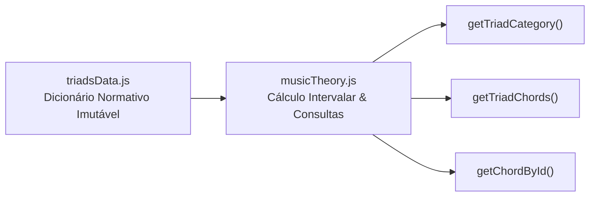

# FEAT-001: Core Harmônico — Design de Arquitetura e Engenharia

**Spec**: [`.specs/features/FEAT-001-Core-Harmonico/spec.md`](spec.md)  
**Status**: Approved  
**Decisora**: Juliana Chaves Palm (Software Engineer & Solution Designer)

---

## 1. Visão Geral da Arquitetura do Módulo

O módulo `musicTheory.js` é o núcleo imutável da teoria musical do sistema. Ele segue o padrão de **Domínio Puro (Pure Domain Layer)** da Clean Architecture: não possui importações de navegador, referências a DOM ou APIs de áudio. Todas as suas operações são funções puras determinísticas e livres de efeitos colaterais.



---

## 2. Análise de Reúso de Código (Code Reuse)

| Componente Existente | Localização | Como Aproveitar / Refatorar |
| :--- | :--- | :--- |
| Nomes de acordes e cifras | `src/script/chords.js` legado | Extrair os nomes e cifras para a estrutura imutável de `triadsData.js`, padronizando enarmonias corretas (ex.: Fá♭ em vez de Mi para a terça de Ré♭ diminuto). |

---

## 3. Componentes e Contratos de Interface

### 3.1. `src/js/core/triadsData.js`
* **Propósito:** Fonte única da verdade (*Single Source of Truth*) para as 4 categorias de tríades.
* **Exportação:**
  ```javascript
  export const TRIAD_CATEGORIES = {
    MAJOR: 'major',
    MINOR: 'minor',
    DIMINISHED: 'diminished',
    AUGMENTED: 'augmented'
  };

  export const TRIAD_DEFINITIONS = {
    [TRIAD_CATEGORIES.DIMINISHED]: {
      id: 'diminished',
      title: 'Acordes Diminutos',
      formula: 'Tríade 1 · ♭3 · ♭5',
      chords: [ /* lista imutável de 12 acordes */ ]
    },
    // Demais 3 categorias...
  };
  ```

### 3.2. `src/js/core/musicTheory.js`
* **Propósito:** Fornecer métodos seguros de consulta e validação de acordes e categorias.
* **Assinaturas:**
  * `getTriadCategory(categoryId)`: retorna objeto com título, fórmula e lista de acordes.
  * `getChordById(chordId)`: busca o acorde pelo identificador alfanumérico.
  * `formatNoteA11y(note)`: retorna a transcrição fonética em português (ex.: `"Mi♭"` $\rightarrow$ `"Mi bemol"`).

---

## 4. Modelo de Dados (Data Models)

```typescript
interface NoteEntity {
  id: string;             // Identificador da nota acústica (ex: "28", "31")
  pitch: string;          // Notação visual (ex: "Dó", "Mi♭", "Sol♭")
  phonetic: string;       // Notação falada para a11y (ex: "Mi bemol")
  semitoneOffset: number; // Distância em semitons a partir da tônica
}

interface ChordEntity {
  id: string;             // Identificador único (ex: "c-diminished")
  name: string;           // Nome formal (ex: "Dó Diminuto")
  symbol: string;         // Cifra musical (ex: "Cm(b5)")
  category: string;       // "diminished" | "major" | "minor" | "augmented"
  notes: [NoteEntity, NoteEntity, NoteEntity]; // Tríade exata de 3 sons
}
```

---

## 5. Riscos e Mitigações (Risks & Concerns)

| Risco / Fragilidade | Severidade | Estratégia de Mitigação |
| :--- | :---: | :--- |
| **Erros de Enarmonia** (misturar sustenidos e bemóis na mesma tríade) | Média | Validar as 48 tríades na suíte de testes unitários `tests/core/musicTheory.test.js`, garantindo que toda terça e quinta respeitem o campo escalar normativo. |
| **Mutação Acidental de Estado** | Baixa | Congelar os objetos de catálogo via `Object.freeze()` em tempo de inicialização, tornando o dicionário estritamente imutável. |
