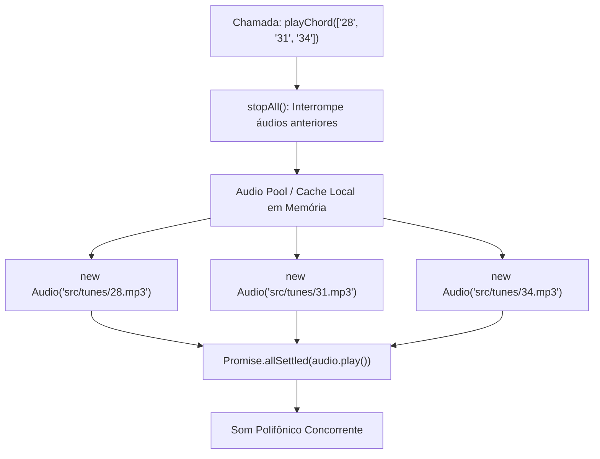

# FEAT-002: Audio Player Modular — Design de Arquitetura e Engenharia

**Spec**: [`.specs/features/FEAT-002-Audio-Player/spec.md`](spec.md)  
**Status**: Approved  
**Decisora**: Juliana Chaves Palm (Software Engineer & Solution Designer)

---

## 1. Visão Geral da Arquitetura do Módulo

O módulo `soundPlayer.js` atua como um adaptador de infraestrutura de áudio (Secondary Adapter na Clean Architecture), isolando o resto da aplicação dos detalhes de baixo nível da API de áudio do navegador (`HTMLAudioElement`). Ele fornece controle polifônico concorrente com latência mínima e tratamento defensivo para restrições de autoplay.



---

## 2. Análise de Reúso de Código (Code Reuse)

| Componente Existente | Localização | Como Aproveitar / Refatorar |
| :--- | :--- | :--- |
| Arquivos de áudio gravados de piano | `src/tunes/*.mp3` (28.mp3 a 53.mp3) | Reutilizar 100% dos arquivos locais existentes, eliminando scripts duplicados de carregamento procedural. |
| Mapeamento prévio de notas | `src/script/chords.js` | Substituir os seletores procedurais imperativos por um mapa declarativo tipado e imutável. |

---

## 3. Componentes e Contratos de Interface

### 3.1. `src/js/audio/soundPlayer.js`
* **Fábrica com Injeção de Dependências:**
  ```javascript
  export function createSoundPlayer({
    basePath = 'src/tunes/',
    audioFactory = (url) => new Audio(url)
  } = {}) {
    // Gerenciamento interno de cache e instâncias ativas
    return {
      playNote(noteId),
      playChord(noteIds),
      stopAll(),
      preload(noteIds)
    };
  }
  ```
* **Vantagem de Engenharia:** Permitir testes unitários determinísticos injetando um `audioFactory` mockado que valida chamadas de `play()` e `pause()` sem depender de hardware de som físico.

---

## 4. Gestão de Ciclo de Vida e Memória

1. **Reutilização de Instâncias (*Audio Pooling*):** Para evitar a criação contínua de objetos `Audio` que sobrecarregam o Garbage Collector, as instâncias de notas já tocadas são armazenadas em um `Map<noteId, HTMLAudioElement>`.
2. **Reinício de Tempo (*Playback Reset*):** Antes de cada execução, `audio.currentTime = 0` é atribuído para garantir que a nota soe imediatamente desde o seu ataque inicial.
3. **Prevenção de Cacofonia (*Overlap Prevention*):** Disparar uma nova tríade pausa instantaneamente as notas do acorde anterior, garantindo clareza harmônica.

---

## 5. Riscos e Mitigações (Risks & Concerns)

| Risco / Fragilidade | Severidade | Estratégia de Mitigação |
| :--- | :---: | :--- |
| **Bloqueio de Autoplay pelo Navegador** | Média | Envolver toda chamada a `audio.play()` em `try/catch` e capturar a rejeição de `NotAllowedError`, inicializando silenciosamente no primeiro clique do usuário. |
| **Atraso Perceptual no Primeiro Clique** | Média | Implementar método `preload()` para aquecer o cache dos áudios das 12 tríades da página atual em segundo plano (*idle time*). |
| **Falha de Carregamento de Arquivo** | Baixa | Fallback seguro emitindo aviso descritivo no console sem interromper a execução ou a acessibilidade visual e textual. |
