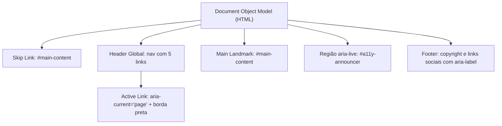

# FEAT-003: Shell de Navegação e Design System — Design de Arquitetura e Engenharia

**Spec**: [`.specs/features/FEAT-003-Shell-Navegacao/spec.md`](spec.md)  
**Status**: Approved  
**Decisora**: Juliana Chaves Palm (Software Engineer & Solution Designer)

---

## 1. Visão Geral da Arquitetura do Módulo

O shell da aplicação provê a moldura comum a todas as 5 páginas do projeto, garantindo consistência visual, semântica WAI-ARIA estrita e cumprimento absoluto dos critérios da WCAG 2.2 AAA.



---

## 2. Análise de Reúso de Código (Code Reuse)

| Componente Existente | Localização | Como Aproveitar / Refatorar |
| :--- | :--- | :--- |
| Cabeçalho e rodapé legados | `src/pages/*.html` | Eliminar inconsistências e duplicações manuais, unificando a estrutura HTML e CSS em torno das 4 camadas normativas (`ADR-002`). |
| Estilos CSS antigos | `src/style/main.css` | Decompor as regras monolíticas em `tokens.css`, `base.css`, `layout.css` e `components.css`. |

---

## 3. Componentes e Contratos de Interface

### 3.1. `src/js/ui/shell.js`
* **Assinatura:**
  ```javascript
  export function initShell({
    document = window.document,
    location = window.location
  } = {}) {
    // Sincroniza página ativa e inicializa container a11y
    return {
      syncActiveNavigation(currentPath),
      getAnnouncerElement()
    };
  }
  ```

### 3.2. `src/js/ui/announcer.js`
* **Assinatura:**
  ```javascript
  export function createAnnouncer({
    announcerElement,
    debounceMs = 100
  }) {
    return {
      announce(message, { priority = 'polite' } = {})
    };
  }
  ```

---

## 4. Engenharia de Tokens e Design System (`src/css/tokens.css`)

```css
:root {
  /* Cores Semânticas de Alto Contraste (WCAG AAA >= 19:1) */
  --color-bg: #ffffff;
  --color-text-primary: #000000;
  --color-text-secondary: #333333;
  --color-border: #e0e0e0;
  --color-border-dark: #000000;
  --color-focus: #000000;

  /* Tipografia Fluida */
  --font-family-sans: -apple-system, BlinkMacSystemFont, "Segoe UI", Roboto, Helvetica, Arial, sans-serif;
  --font-size-title: clamp(2.5rem, 5vw, 4rem);
  --font-size-subtitle: clamp(0.9rem, 2vw, 1.1rem);
  --font-size-body: 1.05rem;
  --line-height-body: 1.6;

  /* Espaçamentos Consistentes */
  --space-xs: 0.25rem;
  --space-sm: 0.5rem;
  --space-md: 1rem;
  --space-lg: 2rem;
  --space-xl: 3.5rem;
}
```

---

## 5. Riscos e Mitigações (Risks & Concerns)

| Risco / Fragilidade | Severidade | Estratégia de Mitigação |
| :--- | :---: | :--- |
| **Quebra de layout em telas mobile** | Média | Uso de container fluido com `max-width: 1100px`, `padding` lateral responsivo e menu com flex-wrap automático sem quebra desordenada. |
| **Poluição de fala em leitores de tela** | Baixa | Adotar `aria-live="polite"` com técnica de substituição limpa de nó de texto (`textContent`), evitando que mensagens antigas continuem sendo vocalizadas em fila atrasada. |
