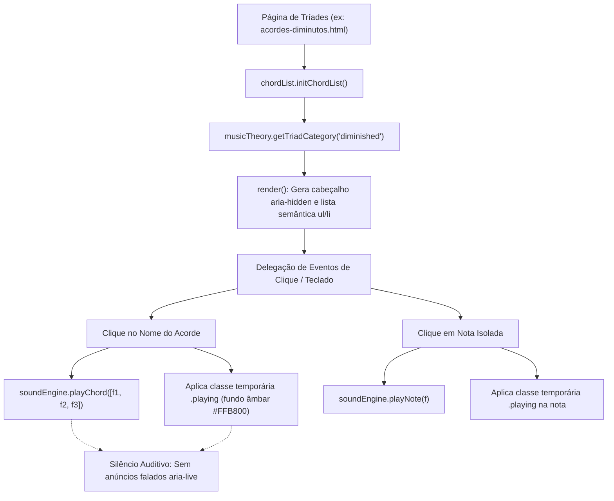

# FEAT-004: Falsa Tabela Estilo ABNT — Design de Arquitetura e Engenharia

**Spec**: [`.specs/features/FEAT-004-Tabelas-Triades/spec.md`](spec.md)  
**Status**: Approved  
**Decisora**: Juliana Chaves Palm (Software Engineer & Solution Designer)

---

## 1. Visão Geral da Arquitetura do Componente

O módulo `chordList.js` orquestra a renderização e o comportamento interativo da **falsa tabela ABNT** nas 4 páginas de estudo de tríades. O componente adota uma lista semântica (`<ul>`/`<li>`), eliminando tags de tabela tradicionais para garantir uma leitura linear sem atrito para tecnologias assistivas. Ele integra o Core de Domínio (`musicTheory.js`) e a síntese procedural em tempo real (`soundEngine.js`), respeitando o princípio de **silêncio auditivo** durante a execução musical.



---

## 2. Estrutura Semântica do DOM Gerado (Zero Tags de Tabela)

```html
<div class="triad-chapter-grid">
  <!-- Coluna Esquerda: Âncora do Capítulo (180px) -->
  <aside class="chapter-sidebar" aria-label="Identificação do capítulo">
    <div class="vertical-title-wrapper">
      <h1 class="chapter-vertical-title">Acordes Diminutos</h1>
      <div class="chapter-vertical-line" aria-hidden="true"></div>
    </div>
    <div class="formula-box">
      <span class="formula-label">Tríade</span>
      <span class="formula-value">1 · ♭3 · ♭5</span>
    </div>
  </aside>

  <!-- Coluna Direita: Conteúdo de Leitura e Falsa Tabela ABNT -->
  <section class="chapter-content" id="lista-acordes" aria-labelledby="chapter-heading">
    <div class="intro-paragraphs">
      <p>Neste guia básico de acordes, você poderá conhecer melhor as tríades, acordes formados por três sons. O conteúdo apresenta informações sobre a construção e as características dos acordes diminutos.</p>
      <p>Clique no nome do acorde para ouvir a tríade completa ou selecione cada nota para escutá-la separadamente.</p>
    </div>

    <!-- Falsa Tabela ABNT: Cabeçalho visual ignorado por leitores de tela -->
    <div class="abnt-table-wrapper">
      <div class="abnt-table-header" aria-hidden="true">
        <span>Acorde</span>
        <span>Cifra</span>
        <span>Notas</span>
      </div>

      <!-- Lista Semântica Real para Tecnologias Assistivas -->
      <ul class="acordes-lista" role="list">
        <!-- Item da Lista (Linha Visual da Tabela) -->
        <li class="acorde-item">
          <!-- Coluna 1: Acorde (Botão de texto que toca a tríade) -->
          <div class="col-acorde">
            <button type="button" class="btn-chord-trigger" data-chord-id="c-diminished"
                    aria-label="Tocar tríade completa de Dó Diminuto">
              Dó Diminuto
            </button>
          </div>

          <!-- Coluna 2: Cifra com camada fonética .sr-only -->
          <div class="col-cifra">
            <span aria-hidden="true">Cm(b5)</span>
            <span class="sr-only">Cifra: Dó menor com quinta diminuta.</span>
          </div>

          <!-- Coluna 3: Notas isoladas clicáveis -->
          <div class="col-notas">
            <button type="button" class="btn-note-trigger" data-freq="261.63"
                    aria-label="Tocar nota individual Dó">Dó</button>
            <span class="note-dot" aria-hidden="true"> · </span>
            <button type="button" class="btn-note-trigger" data-freq="311.13"
                    aria-label="Tocar nota individual Mi bemol">Mi♭</button>
            <span class="note-dot" aria-hidden="true"> · </span>
            <button type="button" class="btn-note-trigger" data-freq="369.99"
                    aria-label="Tocar nota individual Sol bemol">Sol♭</button>
          </div>
        </li>
      </ul>
    </div>
  </section>
</div>
```

---

## 3. Regras CSS ABNT (Apenas 3 Linhas Horizontais)

```css
/* As 3 Linhas Horizontais Normativas da ABNT */
.abnt-table-wrapper {
  border-top: 1.5px solid var(--color-ink);    /* Linha 1: Acima do cabeçalho */
}

.abnt-table-header {
  display: grid;
  grid-template-columns: 2fr 1.2fr 2fr;
  padding: 0.75rem 0;
  font-weight: 600;
  border-bottom: 1.5px solid var(--color-ink); /* Linha 2: Abaixo do cabeçalho */
}

.acordes-lista {
  list-style: none;
  margin: 0;
  padding: 0;
}

.acorde-item {
  display: grid;
  grid-template-columns: 2fr 1.2fr 2fr;
  align-items: center;
  padding: 0.65rem 0;
  /* Sem bordas intermediárias conforme a norma ABNT */
}

.acorde-item:last-child {
  border-bottom: 1.5px solid var(--color-ink); /* Linha 3: Fechamento da tabela */
}
```

---

## 4. Riscos e Mitigações (Risks & Concerns)

| Risco / Fragilidade | Severidade | Estratégia de Mitigação |
| :--- | :---: | :--- |
| **Leitor de tela anunciar números de lista** | Baixa | Utilizar `role="list"` no `<ul>` para assegurar que navegadores Safari/WebKit não descartem a semântica da lista após `list-style: none`. |
| **Conflito entre voz assistiva e áudio** | Média | Regra arquitetural estrita de Silêncio Auditivo: zero emissão de `aria-live` durante a execução das notas. |
| **Foco difícil em telas de alta densidade** | Média | O foco `:focus-visible` e a classe `.playing` aplicam fundo âmbar `#FFB800` vibrante e contorno `3px solid #111111; outline-offset: 2px`. |
