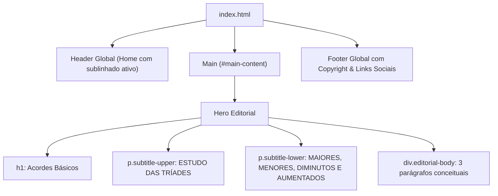

# FEAT-005: Home Editorial — Design de Arquitetura e Engenharia

**Spec**: [`.specs/features/FEAT-005-Home-Editorial/spec.md`](spec.md)  
**Status**: Approved  
**Decisora**: Juliana Chaves Palm

---

## 1. Visão Geral da Arquitetura da Página

A página inicial `index.html` atua como a introdução editorial ao estudo de tríades. Ela prioriza tipografia limpa, hierarquia de leitura escandinava/minimalista e navegação direta para os estudos práticos, correspondendo ao mockup vinculante `captures/home.jpg`.



---

## 2. Análise de Reúso de Código (Code Reuse)

| Componente Existente | Localização | Como Aproveitar / Refatorar |
| :--- | :--- | :--- |
| Textos conceituais legados | `index.html` legado | Adequar a redação e hierarquia para corresponder com fidelidade milimétrica aos 3 parágrafos e subtítulos do mockup da Juliana. |
| Estrutura de reset | `src/style/main.css` legado | Substituir pelo `base.css` moderno com controle tipográfico fluido (`clamp()`) e alinhamento centralizado. |

---

## 3. Componentes e Contratos de Interface

### 3.1. Marcação Semântica Principal
```html
<main id="main-content" class="home-main" tabindex="-1">
  <div class="home-hero-container">
    <header class="home-hero-header">
      <h1 class="home-title">Acordes Básicos</h1>
      <p class="home-subtitle-main">ESTUDO DAS TRÍADES</p>
      <p class="home-subtitle-sub">MAIORES, MENORES, DIMINUTOS E AUMENTADOS</p>
    </header>

    <div class="home-editorial-text">
      <p>Este material apresenta os principais tipos de tríades, acordes formados por três notas.</p>
      <p>O conteúdo aborda os acordes maiores, menores, diminutos e aumentados, destacando sua estrutura, formação e sonoridade.</p>
      <p>Selecione uma categoria no menu para explorar os acordes, compreender sua construção e ouvir cada tríade individualmente.</p>
    </div>
  </div>
</main>
```

---

## 4. Engenharia Tipográfica e Responsividade

1. **Rastreamento de Caracteres (*Letter Spacing*):** O subtítulo `"ESTUDO DAS TRÍADES"` recebe `letter-spacing: 0.25em` para reproduzir o requinte tipográfico do mockup.
2. **Largura Máxima de Leitura (*Measure*):** O container `.home-editorial-text` possui `max-width: 680px` com alinhamento à esquerda, garantindo conforto ergonômico de leitura (entre 60 e 75 caracteres por linha).
3. **Escala Fluida:** Uso de `font-size: clamp(2.5rem, 5vw, 4.2rem)` no título `h1` para ajuste automático suave desde telas pequenas de celular até monitores 4K.

---

## 5. Riscos e Mitigações (Risks & Concerns)

| Risco / Fragilidade | Severidade | Estratégia de Mitigação |
| :--- | :---: | :--- |
| **Quebra de linha desarmônica no subtítulo** | Baixa | Uso de `white-space: nowrap` ou quebras deliberadas sob media queries controladas para evitar orfandade de palavras. |
| **Baixo contraste em telas OLED / IPS** | Baixa | A paleta é preto puro (#000000) sobre branco puro (#ffffff), resultando na razão de contraste máxima possível ($21:1$), superando todos os requisitos da WCAG AAA. |
