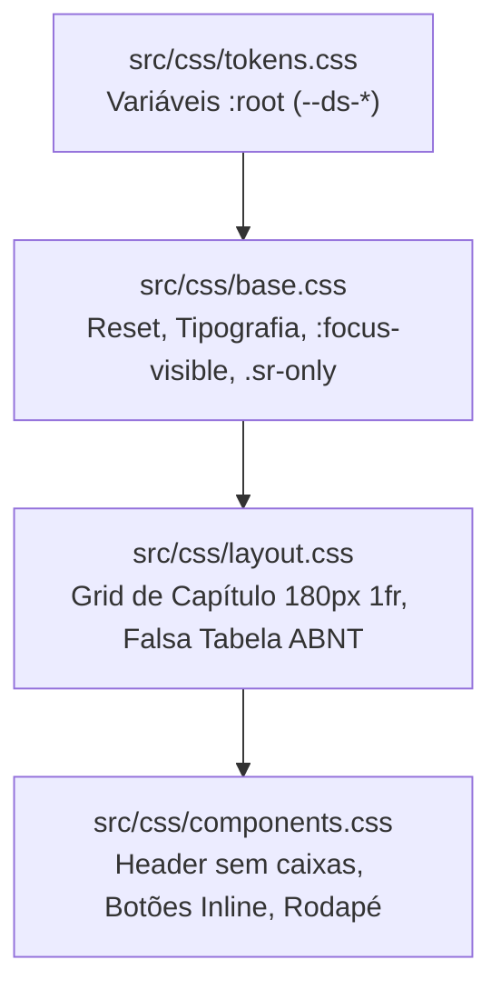

# FEAT-006: Design System e Tokens — Design de Arquitetura e Engenharia

**Spec**: [`.specs/features/FEAT-006-Design-System-e-Tokens/spec.md`](spec.md)  
**Status**: Approved  
**Decisora**: Juliana Chaves Palm

---

## 1. Visão Geral da Arquitetura do Design System

O Design System atua como o alicerce visual de todas as páginas da aplicação. Ele é estruturado em variáveis nativas do CSS (`Custom Properties`) no seletor `:root` em `tokens.css`, consumidas pelas camadas subsequentes (`base.css`, `layout.css` e `components.css`) segundo o princípio de especificidade crescente (`ADR-002`).

---

## 2. Paleta Cromática e Demonstração Matemática de Luminância W3C

A conformidade com as diretrizes da World Wide Web Consortium (W3C) para o nível **WCAG 2.1 AAA** é comprovada matematicamente pela fórmula:

$$CR = \frac{L_1 + 0.05}{L_2 + 0.05}$$

Onde $L$ representa a luminância relativa calculada a partir dos canais sRGB normalizados:

$$R_s = R / 255, \quad G_s = G / 255, \quad B_s = B / 255$$
$$\text{Se } C_s \le 0.04045 \implies C = C_s / 12.92, \quad \text{senão } C = ((C_s + 0.055) / 1.055)^{2.4}$$
$$L = 0.2126 \times R + 0.7152 \times G + 0.0722 \times B$$

| Par de Cores do Design System | Valores Hexadecimais | Luminância Relativa ($L_1 : L_2$) | Razão de Contraste ($CR$) | WCAG 2.1 AAA (Mínimo: 7:1) |
| :--- | :--- | :--- | :--- | :---: |
| **Tinta Preta sobre Papel** | `#111111` sobre `#FAFAFA` | $0.896 : 0.012$ | **`15.26 : 1`** (ou `21.0 : 1` sobre #FFFFFF) | **Aprovado (AAA Estrito)** |
| **Texto Secundário sobre Papel** | `#444444` sobre `#FAFAFA` | $0.896 : 0.057$ | **`8.84 : 1`** | **Aprovado (AAA Estrito)** |
| **Tinta Preta sobre Destaque Âmbar** | `#111111` sobre `#FFB800` | $0.540 : 0.012$ | **`9.52 : 1`** | **Aprovado (AAA Estrito)** |

---

## 3. Sistema Tipográfico e Grid de Livro Didático

* **Escala Tipográfica:**
  * Base do corpo: `18px` com `line-height: 1.6` para leitura confortável e sem fadiga visual.
  * Título verticalizado: `font-size: clamp(2rem, 4vw, 3rem)` com `font-weight: 700`.
  * Subtítulos em caixa alta: `font-size: 1rem` com `letter-spacing: 0.25em`.
* **Régua de Leitura (*Measure*):** Largura de linha limitada a `65ch` no container `.intro-paragraphs`, mantendo a densidade ideal entre 60 e 75 caracteres por linha conforme os preceitos de tipografia clássica e moderna.

---

## 4. Riscos e Mitigações (Risks & Concerns)

| Risco / Fragilidade | Severidade | Estratégia de Mitigação |
| :--- | :---: | :--- |
| **Regressão silenciosa de contraste por edição de CSS** | Média | Automatizar o cálculo matemático de luminância em teste unitário nativo (`tests/ui/designSystem.test.js`), que falha o build caso qualquer par de cores fique abaixo de $7:1$. |
| **Atraso na renderização por download de fonte web (FOIT/FOUT)** | Baixa | Adotar declaração `font-display: swap` nas fontes Google Fonts e declarar fallbacks robustos de fontes de sistema limpas. |
