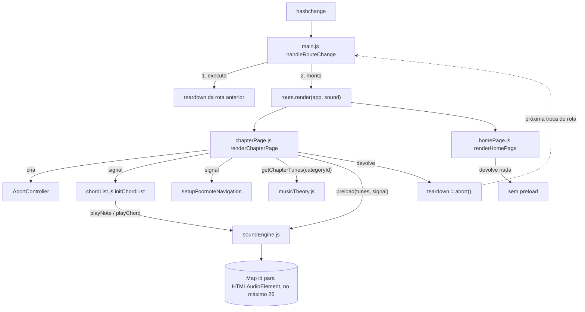

# FEAT-009 Design

**Spec**: `.specs/features/FEAT-009-Otimizacao-de-Runtime-e-Usabilidade/spec.md`
**Status**: Draft
**Decisions**: [ADR-011](../../decisions/ADR-011-audio-pool-and-route-teardown.md) (`AD-011`), [ADR-010](../../decisions/ADR-010-open-text-selection-policy.md) (`AD-010`)

Conformidade com decisões ativas: `AD-001` (zero dependências de runtime: `AbortController`, `requestIdleCallback` e `navigator.connection` são APIs nativas), `AD-004` (a árvore de acessibilidade e o silêncio auditivo não mudam), `AD-005` (código em inglês, comentários em português só quando necessários), `AD-006` (testes com `node --test`).

---

## Architecture Overview

A feature não cria camadas novas. Ela muda o contrato entre quatro módulos existentes: o roteador devolve e executa uma `teardown`, as páginas criam um `AbortController` por montagem, a engine de áudio mantém um pool e o domínio ganha uma consulta pura das amostras de um capítulo.



```mermaid
sequenceDiagram
    actor U as Usuária
    participant R as main.js
    participant C as chapterPage.js
    participant E as soundEngine.js
    participant B as Navegador

    U->>R: hashchange para #/aumentados
    R->>R: executa teardown da rota anterior
    R->>C: render(app, sound)
    C->>C: cria AbortController
    C->>E: preload(21 amostras, signal)
    E->>E: Save-Data ou 2G? se sim, retorna sem baixar
    loop uma amostra por callback ocioso
        E->>B: requestIdleCallback
        E->>E: signal.aborted? se sim, para
        E->>B: cria Audio, preload auto, load
    end
    C-->>R: devolve teardown
    U->>R: hashchange para #/maiores
    R->>C: teardown, abort()
    Note over E: o preload pendente para; as amostras já baixadas ficam no pool
```

---

## Code Reuse Analysis

### Existing Components to Leverage

| Component | Location | How to Use |
| --------- | -------- | ---------- |
| `createSoundEngine` com `audioFactory` injetável | `src/audio/soundEngine.js` | Estender com pool e `preload`; o `audioFactory` injetável já permite testar com `MockAudio` |
| `getTriadChords` | `src/domain/musicTheory.js` | Base de `getChapterTunes`, que reúne os ids `tune` únicos de um capítulo |
| `setupFootnoteNavigation` | `src/ui/chapterPage.js:107` | Reduzir a um único listener delegado e aceitar `{ signal }` |
| `ROUTES` e `handleRouteChange` | `src/main.js` | Guardar e executar a `teardown` devolvida por `route.render` |
| `MockElement` e `MockAudio` | `tests/ui/main.test.js`, `tests/audio/soundEngine.test.js` | Base dos objetos falsos; ganham suporte a `signal` e a contadores |
| `validate-tokens.mjs` e `designSystem.test.js` | `scripts/`, `tests/ui/` | Trocar o fallback para `src/css` por falha explícita |

### Integration Points

| System | Integration Method |
| ------ | ------------------ |
| `index.html` | Sem mudança: já carrega `src/styles/` e `src/main.js` |
| `npm run gate` | Continua com 3 etapas; os testes novos entram em `node --test` |
| GitHub Pages | Sem mudança: caminhos relativos `./public/tunes/` |

---

## Components

### Pool e pré-carregamento (`soundEngine.js`)

- **Purpose**: Reutilizar uma instância de `Audio` por amostra e pré-carregar as amostras de um capítulo sem gastar dados contra a vontade do usuário.
- **Location**: `src/audio/soundEngine.js`
- **Interfaces**:
  - `createSoundEngine(options)` - `options` ganha `connection` e `scheduleIdle`, ambos injetáveis para teste
  - `playNote(tuneId): Promise<void>` e `playChord(tuneIds): Promise<void>` - API atual, agora sobre o pool; `playChord` ignora ids repetidos
  - `stopAll(): void` e `getActiveAudios(): Audio[]` - sem mudança
  - `preload(tuneIds, { signal }): Promise<void>` - agenda uma amostra por callback ocioso; não faz nada com `Save-Data` ou `slow-2g`/`2g`; para quando `signal.aborted`
- **Dependencies**: `Audio`, `navigator.connection`, `requestIdleCallback` (todos opcionais, com fallback)
- **Reuses**: `audioFactory`, `basePath`, `stopAll` atuais

### Consulta das amostras do capítulo (`musicTheory.js`)

- **Purpose**: Dar à página a lista de ids `tune` únicos de um capítulo, em função pura e testável.
- **Location**: `src/domain/musicTheory.js`
- **Interfaces**: `getChapterTunes(categoryId): string[]` - ordenada, sem repetição; `[]` para categoria inválida
- **Dependencies**: `getTriadChords`
- **Reuses**: `getTriadChords`

### Página de capítulo (`chapterPage.js` e `chordList.js`)

- **Purpose**: Montar o capítulo, criar o `AbortController`, iniciar o pré-carregamento e devolver a `teardown`.
- **Location**: `src/ui/chapterPage.js`, `src/ui/chordList.js`
- **Interfaces**:
  - `renderChapterPage(categoryId, soundEngine, mountElement): () => void` - devolve a `teardown`
  - `setupFootnoteNavigation(root, { signal })` - um listener delegado, removido pelo `signal`
  - `initChordList({ containerElement, categoryId, soundEngine, signal })` - listeners de clique ligados ao `signal`; sem `selectstart` nem `copy` (`AD-010`)
- **Dependencies**: `getChapterTunes`, `preload`
- **Reuses**: marcação atual de `renderChordMarkup` e das notas DPUB

### Roteador (`main.js`)

- **Purpose**: Executar a `teardown` da rota anterior antes de montar a próxima.
- **Location**: `src/main.js`
- **Interfaces**: `handleRouteChange(options)` guarda a `teardown` devolvida por `route.render`; `initApp` mantém `{ soundEngine, routeHandler }`
- **Dependencies**: `ROUTES`
- **Reuses**: `normalizeHash`, anúncio de rota, foco no título

### Casca (`shell.js`)

- **Purpose**: Deixar de interceptar cópia e seleção.
- **Location**: `src/ui/shell.js`
- **Interfaces**: remove `preventTextSelectionAndCopy` e a chamada em `initShell`
- **Reuses**: o restante do `initShell`

### Higienização de CSS e documentos

- **Purpose**: Uma só pasta de estilos e nenhum `user-select: none`.
- **Location**: `src/css/` (remover), `src/styles/base.css`, `src/styles/components.css`, `scripts/validate-tokens.mjs`, `tests/ui/*.test.js`, `ADR-002`, `ADR-008`, `style-guide.md`
- **Interfaces**: `validate-tokens.mjs` falha com mensagem clara quando `src/styles/` não existe

---

## Data Models

```typescript
// Pool interno do soundEngine; não é exportado
type AudioPool = Map<string, HTMLAudioElement>; // chave = String(tuneId), no máximo 26 entradas

// Contrato de rota
type Teardown = () => void;
type RouteRender = (app: HTMLElement, sound: SoundEngine | null) => Teardown | void;
```

**Relationships**: `getChapterTunes` alimenta `preload`; `preload` povoa o `AudioPool`; `playNote` e `playChord` leem do mesmo `AudioPool`.

---

## Error Handling Strategy

| Error Scenario | Handling | User Impact |
| -------------- | -------- | ----------- |
| Amostra não carrega ou `play()` rejeita | A entrada sai do pool; as outras amostras do acorde seguem; nenhuma exceção sobe | Aquela nota fica muda; o próximo clique tenta de novo |
| Autoplay bloqueado antes do primeiro gesto | A rejeição é engolida como hoje | Nenhum erro visível |
| `requestIdleCallback` ausente | Fallback para `setTimeout` | Mesmo pré-carregamento, ligeiramente mais cedo |
| `navigator.connection` ausente | Trata como conexão sem restrição e pré-carrega | Sem diferença para navegadores sem a API |
| Troca de rota durante o pré-carregamento | `signal` aborta; nenhuma nova amostra é pedida | Sem consumo extra de dados |
| `route.render` devolve nada (Home) | `main.js` trata como `teardown` vazia | Sem diferença |

---

## Risks & Concerns

| Concern | Location (file:line) | Impact | Mitigation |
| ------- | -------------------- | ------ | ---------- |
| Listener por elemento somado ao delegado na mesma nota | `src/ui/chapterPage.js:114` e `:141` | Handler duplicado a cada clique e a cada visita | Um único listener delegado ligado ao `signal` (HARD-09, HARD-10) |
| `initChapterPage` só é chamada pelos testes e usa `document` como raiz padrão | `src/ui/chapterPage.js:30` | Código morto que reabre o risco de listeners no `document` | Mantida e roteada para o mesmo mecanismo único; remoção fica como ideia adiada |
| `MockAudio` dos testes não tem `addEventListener` nem `load` | `tests/audio/soundEngine.test.js:5` | O pool quebraria nos testes atuais | O pool chama `addEventListener` e `load` só se existirem (`?.`); os testes novos usam um mock completo |
| Testes dependem de `src/css` como fallback | `tests/ui/chapterPage.test.js:153`, `chordList.test.js:170`, `designSystem.test.js:12`, `shell.test.js:7`, `scripts/validate-tokens.mjs:18` | Apagar `src/css/` antes de limpar os fallbacks quebraria o gate | Ordem das tasks: remover os fallbacks primeiro e apagar a pasta por último |
| Testes que exigem o bloqueio de cópia | `tests/ui/chordList.test.js:172` a `:188`, `tests/ui/shell.test.js:297` a `:304` | Os testes atuais passam a contradizer `AD-010` | Reescrever esses testes para exigir a ausência do bloqueio, na mesma task da remoção |
| `.playing` é removida por `setTimeout` depois da troca de rota | `src/ui/chordList.js:119`, `:135` | Timer inofensivo sobre nó já removido | Sem ação; documentado |
| Mesmo id de amostra repetido em um acorde reiniciaria a mesma instância | `src/audio/soundEngine.js:65` | Nota perdida no acorde | `playChord` deduplica ids; o domínio atual não repete ids em um acorde |

---

## Tech Decisions (only non-obvious ones)

| Decision | Choice | Rationale |
| -------- | ------ | --------- |
| Estrutura do pool | `Map` interno ao `createSoundEngine`, sem estado global | Cada teste cria a sua engine; sem vazamento entre testes |
| Granularidade do pré-carregamento | Um callback ocioso por amostra | Permite parar no meio quando o `signal` aborta (HARD-11) |
| Detecção de conexão | `options.connection ?? navigator.connection` | Injetável em teste; `Save-Data` e `effectiveType` são as únicas sinalizações nativas |
| Parar áudio ao trocar de rota | Fora do escopo | A spec não pede; mudaria o comportamento sonoro atual |
| Numeração dos ADRs | `ADR-010` (seleção), `ADR-011` (pool e `teardown`) | O gate exige o mesmo número de ADRs e de decisões `AD` |

---
