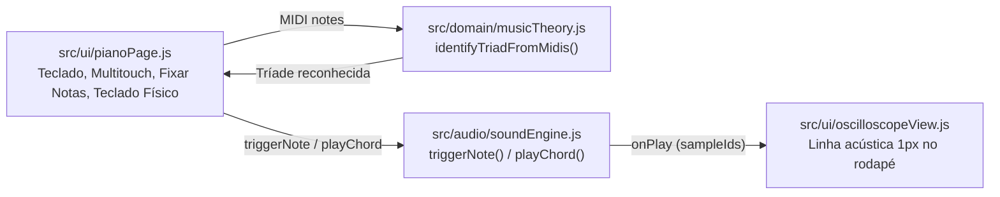

# FEAT-010: Design Arquitetural — Piano Virtual Interativo

## 1. Visão Geral de Componentes

O Piano Virtual segue estritamente a separação de camadas DDD/SOLID do projeto: o domínio reconhece tríades a partir de MIDIs puros, a camada de áudio dispara amostras `.mp3` reais com polifonia aditiva e a camada de UI orquestra multitouch, teclado físico, modo `Fixar notas` e desmontagem via `AbortController`.

## 2. Mapeamento das Teclas e Atalhos de Teclado Físico

Extensão total: **25 teclas** (2 oitavas completas, MIDI `60` = Dó4 até MIDI `84` = Dó6), todas cobertas pelos arquivos gravados `public/tunes/28.mp3` a `52.mp3`.

- **1ª Oitava (visível em portrait e landscape — MIDI 60 a 72):**
  - Brancas: `Dó` (60, `a`), `Ré` (62, `s`), `Mi` (64, `d`), `Fá` (65, `f`), `Sol` (67, `g`), `Lá` (69, `h`), `Si` (71, `j`), `Dó` (72, `k`).
  - Pretas: `Dó♯` (61, `w`), `Ré♯` (63, `e`), `Fá♯` (66, `t`), `Sol♯` (68, `y`), `Lá♯` (70, `u`).
- **2ª Oitava (expandida automaticamente em desktop e mobile landscape — MIDI 73 a 84):**
  - Brancas: `Ré` (74), `Mi` (76), `Fá` (77), `Sol` (79), `Lá` (81), `Si` (83), `Dó` (84).
  - Pretas: `Dó♯` (73), `Ré♯` (75), `Fá♯` (78), `Sol♯` (80), `Lá♯` (82).

## 3. Fluxo de Interação e Estado Local (Zero Estado Global)

Todo estado do piano reside encapsulado dentro da closure de `renderPianoPage(soundEngine, mountElement)` e é descartado automaticamente no `teardown()`:
- `activePointers = new Map()` (`pointerId -> midi`): garante multitouch limpo no celular (cada dedo liga e desliga apenas sua própria tecla).
- `activePhysicalKeys = new Set()` (`midi`): permite acordes simultâneos no teclado físico sem disparar repetições automáticas (`e.repeat`).
- `pinnedNotes = new Set()` (`midi`): gerencia as notas marcadas quando `Fixar notas` está ligado.
- `isPinMode = false`: alternado exclusivamente pelo botão `Fixar notas`.

## 4. Layout Editorial Suíço, Console Preto e Responsividade

- **Console Unificado (`.piano-console`):** envolve `.piano-toolbar` (4 botões táteis escuros com ícones homologados: `Fixar notas`, `Limpar`, `Tocar juntas`, `Como usar`) e `.piano-stage` (`.piano-keyboard` centralizado horizontalmente sem vãos entre teclas) em um chassi preto de moldura fina (`border-radius: 14px`, `10px` em celular horizontal), sombra calibrada (`--ds-console-shadow`) e destaque âmbar (`--ds-color-accent-amber`) no estado ativo.
- **Distribuição Vertical:** `.piano-layout` usa `justify-content: center; gap: clamp(16px, 3vh, 32px);`, centralizando o console como peça única equilibrada entre a *hairline* da topbar e a linha do osciloscópio no rodapé em desktop, tablet e celular.
- **Escala Auto-Proporcional (`computePianoScale`):** calcula dinamicamente o modo (`two-octaves` -> `one-octave` -> `major-seventh`) e a altura exata das teclas a partir da altura útil de `.piano-layout`, descontando aviso de orientação (apenas `<= 649px`), barra de controles e moldura do console, garantindo zero rolagem vertical em qualquer proporção.
- **Popover `Como usar` (`.piano-help-popover`):** cabeçalho com *hairline* recuada alinhada ao grid (`--ds-space-xl` no desktop, `--ds-space-md` no tablet/mobile); corpo em grid editorial suíço de 2 colunas no desktop e tablet horizontal (instruções à esquerda com `<em>` nos nomes dos botões; tabela `Atalhos no teclado` em 1 coluna à direita com cabeçalho `1.5px` ABNT) e coluna única `100%` de largura em telas verticais.
- **Indicador Dinâmico no Rodapé (`#footer-cifra`):** exibe notas tocadas ou tríade reconhecida à esquerda da linha acústica de `1px` do osciloscópio, retornando à linha limpa quando nenhuma nota está ativa.

## 5. Acessibilidade (WCAG 2.1 AAA)

- Cada tecla é um `<button type="button" class="piano-key ..." data-midi="60" aria-label="Dó">` com rótulo visual conciso e descrição fonética completa no `aria-label`.
- Quando `Fixar notas` está ativo, cada tecla recebe `aria-pressed="true|false"`.
- O visor de tríade reconhecida usa `aria-live="polite"` e `aria-atomic="true"`, atualizando apenas quando uma tríade é identificada ou limpa — preservando o silêncio auditivo no toque de notas isoladas (`ADR-004`).
- `window.addEventListener('keydown'/'keyup', ..., { signal })` é cancelado automaticamente no `teardown()` ao sair da aba `#/piano` (`ADR-011`).
