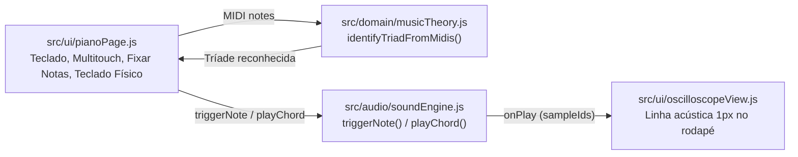

# FEAT-010: Design Arquitetural — Piano Virtual Interativo

## 1. Visão Geral de Componentes

O Piano Virtual segue estritamente a separação de camadas DDD/SOLID do projeto: o domínio reconhece tríades a partir de MIDIs puros, a camada de áudio dispara amostras `.mp3` reais com polifonia aditiva e a camada de UI orquestra multitouch, teclado físico, modo `Fixar notas` e desmontagem via `AbortController`.

## 2. Mapeamento das Teclas e Atalhos de Teclado Físico

Extensão total: **25 teclas** (2 oitavas completas, MIDI `60` = Dó4 até MIDI `84` = Dó6), todas cobertas pelos arquivos gravados `public/tunes/28.mp3` a `52.mp3`.

- **1ª Oitava (visível em portrait e landscape — MIDI 60 a 72):**
  - Brancas: `Dó` (60, `a`), `Ré` (62, `s`), `Mi` (64, `d`), `Fá` (65, `f`), `Sol` (67, `g`), `Lá` (69, `h`), `Si` (71, `j`), `Dó` (72, `k`).
  - Pretas: `Dó♯` (61, `w`), `Ré♯` (63, `e`), `Fá♯` (66, `t`), `Sol♯` (68, `y`), `Lá♯` (70, `u`).
- **2ª Oitava (expandida automaticamente em desktop e mobile landscape — MIDI 73 a 84):**
  - Brancas: `Ré` (74), `Mi` (76), `Fá` (77), `Sol` (79), `Lá` (81), `Si` (83), `Dó` (84).
  - Pretas: `Dó♯` (73), `Ré♯` (75), `Fá♯` (78), `Sol♯` (80), `Lá♯` (82).

## 3. Fluxo de Interação e Estado Local (Zero Estado Global)

Todo estado do piano reside encapsulado dentro da closure de `renderPianoPage(soundEngine, mountElement)` e é descartado automaticamente no `teardown()`:
- `activePointers = new Map()` (`pointerId -> midi`): garante multitouch limpo no celular (cada dedo liga e desliga apenas sua própria tecla).
- `activePhysicalKeys = new Set()` (`midi`): permite acordes simultâneos no teclado físico sem disparar repetições automáticas (`e.repeat`).
- `pinnedNotes = new Set()` (`midi`): gerencia as notas marcadas quando `Fixar notas` está ligado.
- `isPinMode = false`: alternado exclusivamente pelo botão `Fixar notas`.

## 4. Layout Editorial Suíço e Responsividade

- **Desktop (> 960px):** 2 oitavas completas centralizadas na largura do contêiner editorial (até `1200px`), barra superior minimalista com `[ Fixar notas ] [ Tocar juntas ] [ Limpar ]` à esquerda e visor de notas/tríade reconhecida à direita.
- **Mobile Landscape (`@media (max-width: 960px) and (orientation: landscape)`):** 2 oitavas completas, espaçamentos verticais compactados para o teclado aproveitar toda a altura disponível acima do rodapé com osciloscópio.
- **Mobile Portrait (`@media (max-width: 960px) and (orientation: portrait)`):** exibe aviso discreto (*"Para tocar com duas oitavas e multitouch, gire o celular na horizontal"*) e oculta visualmente apenas as teclas da 2ª oitava (`data-octave="2"`), mantendo 1 oitava confortável (13 teclas largas) totalmente funcional.
- **Estética:** `border-radius: 0` em todas as teclas e botões, bordas finas em `var(--ds-color-line)`, teclas ativas/fixadas em `var(--ds-color-accent-amber)` com texto `var(--ds-color-ink)`.

## 5. Acessibilidade (WCAG 2.1 AAA)

- Cada tecla é um `<button type="button" class="piano-key ..." data-midi="60" aria-label="Dó">` com rótulo visual conciso e descrição fonética completa no `aria-label`.
- Quando `Fixar notas` está ativo, cada tecla recebe `aria-pressed="true|false"`.
- O visor de tríade reconhecida usa `aria-live="polite"` e `aria-atomic="true"`, atualizando apenas quando uma tríade é identificada ou limpa — preservando o silêncio auditivo no toque de notas isoladas (`ADR-004`).
- `window.addEventListener('keydown'/'keyup', ..., { signal })` é cancelado automaticamente no `teardown()` ao sair da aba `#/piano` (`ADR-011`).
