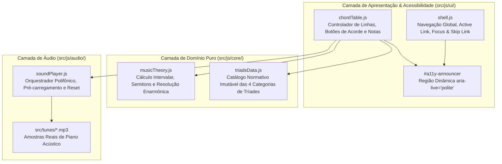
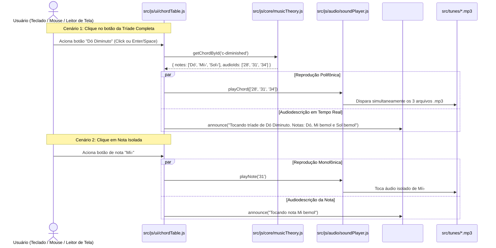

# Visão Geral da Arquitetura — Arquitetura Modular Enxuta (`ADR-001`) & Orquestração Harmônica (`ADR-003`)

## 1. Princípios Arquiteturais e Solution Design

A arquitetura do projeto `acordes` aplica **Spec-Driven Development (SDD)**, **Clean Architecture** e **Arquitetura Web Modular Enxuta** (`ADR-001`) para o ensino de harmonia musical básica e tríades, com foco primário em **acessibilidade universal para pessoas com deficiência visual**.

O objetivo de Solution Design é alcançar **máxima sofisticação técnica por meio da simplicidade intencional (zero over-engineering)**:

1. **Separação Estrita de Camadas (Clean Architecture):**
   * **Core de Domínio (`src/js/core/`):** Teoria musical pura, enarmonia e cálculo intervalar sem nenhuma dependência de DOM, áudio ou navegadores.
   * **Adaptador de Áudio (`src/js/audio/`):** Orquestrador polifônico e monofônico desacoplado, gerenciando os arquivos `.mp3` de piano acústico em `src/tunes/`.
   * **Camada de Apresentação e Interação (`src/js/ui/`):** Controladores de tabela, cabeçalho global, indicador de página ativa e anunciador dinâmico de acessibilidade (`aria-live`).
2. **Zero Runtime Dependencies (`ADR-001`):** A aplicação para o usuário final roda 100% nativa no navegador sem nenhum framework pesado em tempo de execução (sem React, Vue ou Angular), garantindo carregamento instantâneo e hospedagem gratuita e perene via GitHub Pages.
3. **Acessibilidade Universal e Audiodescrição (`ADR-004`):** Cada interação (clique ou navegação por teclado) dispara simultaneamente o áudio da nota/tríade e atualiza o anunciador fonético `#a11y-announcer` (`aria-live="polite"`), garantindo autonomia plena com leitores de tela (NVDA, JAWS, TalkBack).
4. **Arquitetura CSS em 4 Camadas (`ADR-002`):** `tokens.css` → `base.css` → `layout.css` → `components.css`.
5. **Automação BDD com Gherkin e Playwright (`ADR-007`):** Cenários executáveis de ponta a ponta rodando em navegadores reais em Pull Requests e com agendamento diário preventivo (cron) no GitHub Actions.

---

## 2. Estrutura de Diretórios e Stack Técnica

```text
acordes/
├── index.html                        # Home editorial conceitual (apresentação das tríades)
├── acordes-maiores.html              # Estudo prático e tabela de tríades maiores
├── acordes-menores.html              # Estudo prático e tabela de tríades menores
├── acordes-diminutos.html            # Estudo prático e tabela de tríades diminutas
├── acordes-aumentados.html           # Estudo prático e tabela de tríades aumentadas
├── package.json                      # Metadados, scripts de teste nativo e dependências de dev
├── scripts/
│   └── validate-sdd.mjs              # Gate determinístico de validação SDD
├── src/
│   ├── css/
│   │   ├── tokens.css                # 1. Tokens de design (:root e modo monocromático AAA)
│   │   ├── base.css                  # 2. Reset, tipografia fluida, focus-visible e reduced-motion
│   │   ├── layout.css                # 3. Grid editorial: coluna de fórmula da tríade e área central
│   │   └── components.css            # 4. Header com active-link, tabela semântica e rodapé social
│   ├── js/
│   │   ├── core/
│   │   │   ├── musicTheory.js        # Regras imutáveis de intervalos, escalas e tríades
│   │   │   └── triadsData.js         # Dicionário normativo das 4 categorias e enarmonias
│   │   ├── audio/
│   │   │   └── soundPlayer.js        # Orquestrador de reprodução polifônica e monofônica
│   │   └── ui/
│   │       ├── shell.js              # Inicialização do cabeçalho, skip-link e anunciador
│   │       ├── chordTable.js         # Controlador da tabela de acordes e disparo de eventos
│   │       └── home.js               # Controlador da página inicial editorial
│   └── tunes/                        # Amostras acústicas de piano (28.mp3 a 53.mp3)
├── tests/
│   ├── core/
│   │   └── musicTheory.test.js       # Testes unitários puros da teoria musical (node --test)
│   ├── audio/
│   │   └── soundPlayer.test.js       # Testes do orquestrador de áudio e polifonia
│   ├── ui/
│   │   ├── shell.test.js             # Testes de navegação, foco e landmarks ARIA
│   │   └── chordTable.test.js        # Testes de renderização de tabelas e botões acessíveis
│   ├── features/
│   │   └── *.feature                 # Cenários BDD executáveis em sintaxe Gherkin
│   └── steps/
│       └── *.steps.js                # Step definitions automatizados com Playwright
└── .specs/                           # Governança SDD completa (STATE.md, ADRs, features, project)
```

---

## 3. Diagrama da Arquitetura Modular Enxuta



---

## 4. Diagrama de Sequência: Interação Harmônica e Acessibilidade



---

## 5. Estratégia de Engenharia e Padrões de Código (`ADR-005`)

* **Código em Inglês:** Todos os módulos, métodos, funções, identificadores, propriedades e seletores CSS são estritamente escritos em inglês técnico (`playChord`, `getTriadCategory`, `.chord-row`, `#main-content`).
* **Princípio Clean Code:** O código é autoexplicativo por seu design, convenção de nomenclatura e responsabilidade única. Comentários só existem quando estritamente necessários e, nesses casos específicos, são redigidos em português do Brasil de forma clara e contextual.
