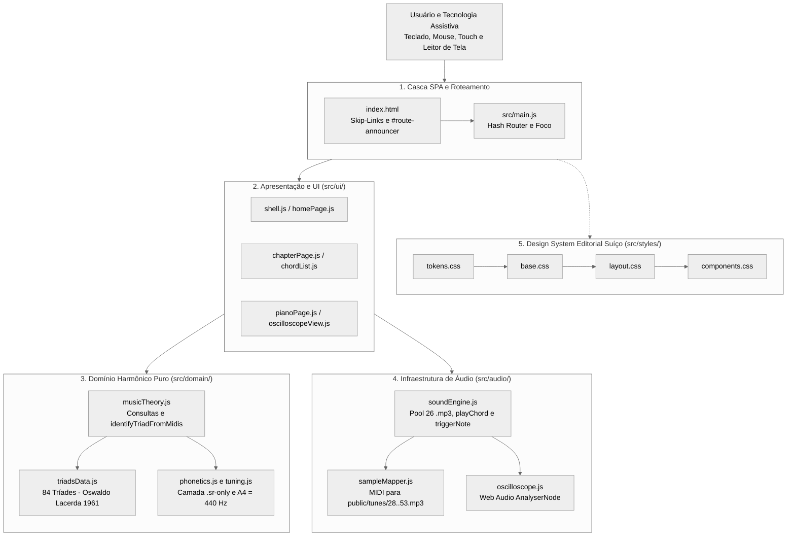
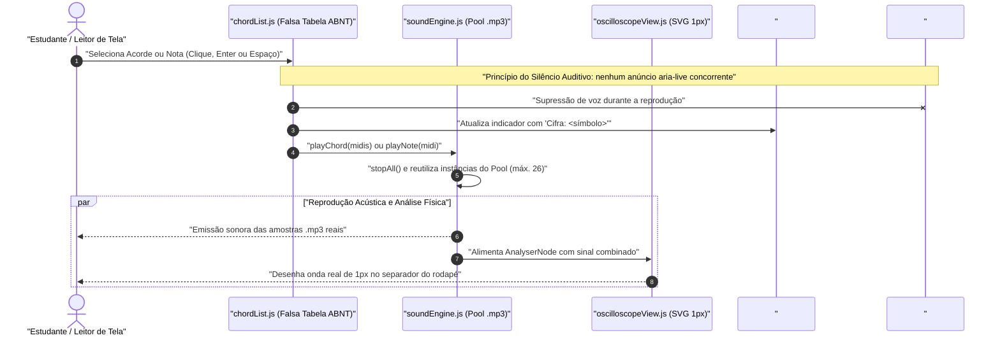
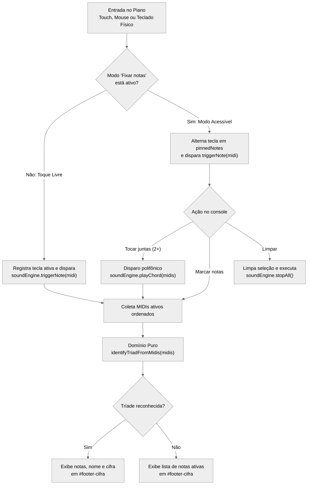
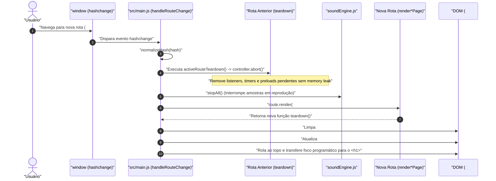

# Acordes Básicos: Guia Acessível de Formação de Tríades

> Aplicação educacional de teoria harmônica e prática auditiva com arquitetura front-end modular em ES6 nativo, acessibilidade WCAG 2.1 AAA (*assistive-first*), áudio acústico real e governança por Spec-Driven Development (SDD).

[](https://github.com/julianachavespalm/acordes/actions)
[](https://www.w3.org/WAI/WCAG21/quickref/?currentsidebar=%23col_customize&levels=aaa)
[](#8-cobertura-de-testes-9661)
[-blue.svg)](#6-stack-tecnológica-e-estrutura-de-pastas)
[](https://creativecommons.org/licenses/by/4.0/)

**Aplicação em Produção:** [https://julianachavespalm.github.io/acordes/](https://julianachavespalm.github.io/acordes/)

---

## 1. Objetivo e Contexto (Origem TCC)

O **Acordes Básicos** nasceu originalmente como um **Trabalho de Conclusão de Curso (TCC)** dedicado ao ensino acessível de formação de tríades musicais para pessoas cegas e com baixa visão. A partir da base pedagógica original, o projeto foi evoluído para uma arquitetura front-end moderna, sem dependências de runtime, com rigor editorial suíço, modelagem de domínio harmônico pura e conformidade contínua auditada por testes automatizados.

A aplicação resolve uma lacuna recorrente em materiais didáticos de teoria musical na web: a dependência de partituras em imagem, tabelas HTML ruidosas em leitores de tela e sintetizadores artificiais. Aqui, cada acorde e nota é uma entidade semântica navegável por teclado, com transcrição fonética dedicada, execução de amostras reais de piano acústico e visualização física da forma de onda em tempo real.

---

## 2. Referência Bibliográfica e Domínio Musical

Todo o catálogo harmônico e as regras de grafia musical do projeto seguem estritamente a obra de referência:

> LACERDA, Oswaldo. *Compêndio de Teoria Elementar da Música*. São Paulo: Ricordi Brasileira, 1961.

### 2.1. Catálogo Normativo das 84 Tríades

O domínio musical em `src/domain/` modela de forma imutável as **4 categorias fundamentais de tríades**, com **21 tonalidades cada** (totalizando **84 tríades normativas**), respeitando a ortografia enarmônica rigorosa da teoria clássica — incluindo dobrados bemóis, dobrados sustenidos e o **triplo sustenido** nas tríades aumentadas, documentado por nota de rodapé acessível WAI-ARIA DPUB:

| Categoria | Rota SPA | Fórmula Intervalar | Quantidade |
| :--- | :--- | :--- | :--- |
| **Acordes Maiores** | `#/maiores` | `1 · 3 · 5` | 21 tríades |
| **Acordes Menores** | `#/menores` | `1 · ♭3 · 5` | 21 tríades |
| **Acordes Diminutos** | `#/diminutos` | `1 · ♭3 · ♭5` | 21 tríades |
| **Acordes Aumentados** | `#/aumentados` | `1 · 3 · ♯5` | 21 tríades |

### 2.2. Piano Virtual Interativo (`#/piano`)

Além dos capítulos de estudo tabular, a aplicação oferece um **Piano Virtual Interativo** desenvolvido inicialmente como uma experimentação para o professor de música do **Instituto Benjamin Constant**, **Denis Martino Cota**, que precisava de um recurso rápido e prático em momentos de demonstração para seus alunos cegos e com baixa visão:

- **Extensão:** 25 teclas (MIDI `60` a `84`, de Dó central a Dó superagudo), com escala auto-proporcional em 3 níveis conforme a largura disponível (`2 oitavas` -> `1ª oitava` -> `7ª maior`).
- **Áudio 100% Acústico:** Reprodução baseada em **26 amostras reais gravadas de piano** (`public/tunes/28.mp3` a `53.mp3`), com pool limitado de instâncias (`MAX_POOL_SIZE = 26`) e zero síntese por oscilador artificial.
- **Reconhecimento Harmônico em Tempo Real:** Ao acionar ou fixar 3 notas compatíveis com o catálogo normativo, a função pura `identifyTriadFromMidis()` reconhece a tríade e exibe a leitura unificada no rodapé (`#footer-cifra`).

---

## 3. Acessibilidade Universal (Assistive-First — WCAG 2.1 AAA)

A acessibilidade não é tratada como camada posterior, mas como requisito estrutural de arquitetura:

- **Contraste Absoluto AAA:** Tipografia em tinta preta (`#111111`) sobre papel off-white (`#FAFAFA`), alcançando razão de contraste de **17.8:1** (acima do mínimo de 7:1 exigido pelo nível AAA).
- **Foco Visível de Alto Contraste:** Contorno unificado `3px solid #111111` com destaque âmbar (`#FFB703`) para navegação por teclado sem ambiguidade.
- **Falsa Tabela ABNT (Zero `<table>`):** As listas de tríades são renderizadas como listas semânticas `<ul role="list">` e `<li>`, com cabeçalho visual marcado como `aria-hidden="true"`. Isso preserva a estética tabular ABNT enquanto elimina o ruído repetitivo de coordenadas de linha e coluna em leitores de tela (NVDA, VoiceOver, JAWS, Narrador).
- **Camada Fonética `.sr-only`:** Cifras e acidentes complexos (sustenidos, bemóis, dobrados e triplos) possuem transcrição fonética explícita para leitura natural por sintetizadores de voz.
- **Princípio do Silêncio Auditivo:** Durante o disparo de notas ou acordes nas tabelas, anúncios `aria-live` concorrentes são suprimidos para que a voz do leitor de tela não interfira na percepção acústica do acorde.
- **Duplo Skip-Link e Teclado Integral:** Links de salto direto (`Ir para o conteúdo principal` e `Ir para o menu`) no topo do DOM, gestão programática de foco para o título `<h1>` a cada mudança de rota e suporte integral a teclado.
- **Notas de Rodapé WAI-ARIA DPUB:** Ocorrências teóricas especiais (como o triplo sustenido) utilizam semântica editorial padronizada com `role="doc-noteref"`, `role="doc-footnote"` e retorno bidirecional de foco via `role="doc-backlink"`.
- **Piano Virtual Acessível e Colofão Autoral:** Modo `Fixar notas` (alternativa acessível ao multitouch para montar e ouvir acordes passo a passo), atalhos de teclado físico no desktop (`A` a `K` para teclas brancas; `W, E, T, Y, U` para pretas), diálogo de instruções (`Como usar`) fechável por `Escape` e colofão autoral no rodapé com `aria-label` explícito (`Juliana Chaves Palm, abrir GitHub em nova aba`).

---

## 4. Arquitetura e Fluxos de Regras de Negócio (Diagramas Mermaid)

A aplicação segue separação estrita de responsabilidades inspirada em **Clean Architecture** e **DDD Pragmático**, isolando o domínio harmônico puro (`src/domain/`, zero dependência de DOM) das camadas de apresentação (`src/ui/`), infraestrutura de áudio (`src/audio/`) e estilos (`src/styles/`).

### 4.1. Visão Arquitetural em Camadas (C4 / DDD)



### 4.2. Fluxo 1: Estudo nas Tabelas de Tríades



### 4.3. Fluxo 2: Piano Virtual (Toque Livre/Multitouch vs. Modo Fixar Notas)



### 4.4. Fluxo 3: Ciclo de Vida SPA e Desmontagem de Rotas



---

## 5. Design System Editorial Suíço e Padrão ABNT

O visual do projeto aplica os princípios do **Estilo Tipográfico Internacional (Design Suíço)** combinados às convenções normativas de tabelas da **ABNT**, governados por **4 camadas CSS** carregadas em cascata estrita:

| Camada | Arquivo | Responsabilidade |
| :--- | :--- | :--- |
| **1. Tokens** | `src/styles/tokens.css` | Fonte única da verdade (`--ds-*`): paleta WCAG AAA, escala modular, espaçamentos, foco, superfícies do piano e console preto (`--ds-console-*`). |
| **2. Base** | `src/styles/base.css` | Reset mínimo, tipografia neo-grotesca (`Inter`, entrelinha `1.6`), anel de foco AAA e cantos retos editoriais. |
| **3. Layout** | `src/styles/layout.css` | Macroestrutura responsiva, grid assimétrico de capítulo (sidebar + coluna de leitura `65ch`), cabeçalho fixo e rodapé. |
| **4. Componentes** | `src/styles/components.css` | Falsa Tabela ABNT, notas de rodapé DPUB, osciloscópio SVG, gaveta mobile e console preto do Piano Virtual. |

### Diretrizes Visuais Normativas

- **Hierarquia de Filetes ABNT:**
  - `1.5px` sólido (`#111111`) no topo e na base do cabeçalho da tabela de tríades;
  - `1px` sólido (`#111111`) no filete superior de notas de rodapé DPUB e no traço do osciloscópio;
  - `1px` sutil (`rgba(17, 17, 17, 0.08)`) na barra superior, no cabeçalho de popovers e entre linhas internas das tabelas (com última linha aberta).
- **Alinhamento às Margens do Grid:** Filetes horizontais (topbar, popovers e osciloscópio do rodapé) respeitam o recuo lateral exato do grid (`48px` em desktop via `--ds-space-xl` e `16px` em tablet/celular via `--ds-space-md`).
- **Console do Piano Virtual:** Chassi preto integrado (`--ds-console-bg`) com moldura fina arredondada, 4 controles táteis escuros (`Fixar notas`, `Limpar`, `Tocar juntas`, `Como usar`) e leito de teclas encostadas em proporção real.
- **Distribuição Vertical por Natureza do Conteúdo:** Páginas de leitura e tabelas são ancoradas ao topo para leitura contínua; o console do Piano Virtual é centralizado verticalmente como instrumento único entre topbar e rodapé.

---

## 6. Stack Tecnológica e Estrutura de Pastas

- **Linguagem e Runtime:** JavaScript ES6+ nativo (ES Modules), HTML5 semântico e CSS3 nativo com Custom Properties.
- **Dependências de Runtime:** **Zero** (sem frameworks SPA, sem bundlers, sem bibliotecas externas em produção).
- **Áudio e Sinal:** HTML5 Audio Pool (`public/tunes/*.mp3`) + Web Audio API (`AnalyserNode`).
- **Qualidade e Testes:** Node.js `>= 20.0.0` com runner nativo `node --test`, asserções `node:assert`, cobertura nativa (`--experimental-test-coverage`) e validadores determinísticos em `scripts/`.

```text
acordes/
├── .github/
│   └── workflows/
│       └── ci.yml                      # Pipeline de CI com Quality Gate determinístico
├── .specs/                             # Governança SDD (Spec-Driven Development)
│   ├── STATE.md                        # Decisões ativas (AD-001 a AD-012) e estado de handoff
│   ├── decisions/                      # Architecture Decision Records (ADR-001 a ADR-012)
│   ├── features/                       # Especificações normativas (FEAT-001 a FEAT-010)
│   └── project/                        # Visão, atributos de qualidade e glossário
├── public/
│   ├── favicon.ico
│   └── tunes/                          # 26 amostras reais gravadas de piano (28.mp3 a 53.mp3)
├── scripts/
│   ├── lib/ui.mjs                      # Formatador de saída CLI dos validadores
│   ├── gate.mjs                        # Orquestrador unificado do Quality Gate
│   ├── serve.mjs                       # Servidor HTTP estático local nativo
│   ├── validate-sdd.mjs                # Auditor de integridade SDD (ADRs, Features, STATE)
│   └── validate-tokens.mjs             # Guardião estático contra valores literais fora de tokens.css
├── src/
│   ├── main.js                         # Composition Root, roteador hash SPA e gestão de foco
│   ├── audio/
│   │   ├── oscilloscope.js             # Analisador acústico via Web Audio AnalyserNode
│   │   ├── sampleMapper.js             # Conversão pura MIDI -> arquivo .mp3 (28..53)
│   │   └── soundEngine.js              # Pool de áudio, playChord, playNote e triggerNote
│   ├── domain/                         # Domínio Harmônico Puro (Zero DOM)
│   │   ├── musicTheory.js              # Facade de consultas e identifyTriadFromMidis()
│   │   ├── phonetics.js                # Transcrição fonética para leitores de tela
│   │   ├── triadsData.js               # Catálogo fechado das 84 tríades (Oswaldo Lacerda 1961)
│   │   └── tuning.js                   # Frequências em Hz (afinação temperada A4 = 440 Hz)
│   ├── styles/
│   │   ├── tokens.css                  # Camada 1: Variáveis normativas --ds-*
│   │   ├── base.css                    # Camada 2: Reset, tipografia e foco AAA
│   │   ├── layout.css                  # Camada 3: Grid editorial e responsividade
│   │   └── components.css              # Camada 4: Falsa Tabela ABNT, DPUB e Piano Console
│   └── ui/
│       ├── chapterPage.js              # Renderização de capítulos e notas WAI-ARIA DPUB
│       ├── chordList.js                # Falsa Tabela ABNT e gatilhos de reprodução
│       ├── homePage.js                 # Capa editorial da Home
│       ├── oscilloscopeView.js         # Renderização SVG da linha de 1px no rodapé
│       ├── pianoPage.js                # Piano Virtual (escala proporcional, multitouch, Fixar notas)
│       └── shell.js                    # Header, menu responsivo, skip-links e aba ativa
├── tests/                              # Suíte de testes automatizados (node --test)
│   ├── audio/                          # Testes do soundEngine, sampleMapper e oscilloscope
│   ├── core/                           # Testes das 84 tríades, fonética, afinação e reconhecimento
│   └── ui/                             # Testes de rotas, teardown, A11y, Design System e Piano
├── index.html                          # Casca SPA única pré-renderizada
├── package.json                        # Scripts oficiais e metadados do projeto
└── README.md                           # Documentação técnica e arquitetural
```

---

## 7. Como Executar e Quality Gate

### Pré-requisitos

- **Node.js `>= 20.0.0`** (nenhuma instalação de dependências de runtime é necessária).

### Comandos Disponíveis

```bash
# Clonar o repositório
git clone https://github.com/julianachavespalm/acordes.git
cd acordes

# Iniciar servidor local de desenvolvimento (http://localhost:3000)
npm start

# Executar a suíte completa de testes unitários e de integração (node --test)
npm test

# Validar conformidade SDD (ADRs, Features e STATE.md)
npm run validate:specs

# Validar governança estática de tokens CSS (proíbe valores literais fora de tokens.css)
npm run validate:tokens

# Executar o Quality Gate completo (SDD + Tokens CSS + Testes)
npm run gate

# Gerar relatório nativo de cobertura de testes via Node.js
node --test --experimental-test-coverage
```

---

## 8. Cobertura de Testes (96.61%)

A suíte conta com **92 testes automatizados em 10 suítes** (0 falhas), executados em ~275 ms no runner nativo do Node.js (`node --test --experimental-test-coverage`), atingindo **96.61% de cobertura de linhas**:

| Módulo (`src/`) | Linhas (%) | Funções (%) |
| :--- | :---: | :---: |
| `src/domain/musicTheory.js` | 100.00% | 100.00% |
| `src/domain/phonetics.js` | 100.00% | 100.00% |
| `src/domain/triadsData.js` | 100.00% | 100.00% |
| `src/domain/tuning.js` | 100.00% | 100.00% |
| `src/audio/sampleMapper.js` | 100.00% | 100.00% |
| `src/ui/homePage.js` | 100.00% | 100.00% |
| `src/ui/chapterPage.js` | 99.43% | 87.50% |
| `src/ui/chordList.js` | 97.65% | 86.67% |
| `src/ui/oscilloscopeView.js` | 96.10% | 100.00% |
| `src/audio/soundEngine.js` | 95.98% | 91.30% |
| `src/main.js` | 93.14% | 72.73% |
| `src/audio/oscilloscope.js` | 92.35% | 90.00% |
| `src/ui/pianoPage.js` | 91.73% | 91.18% |
| `src/ui/shell.js` | 90.18% | 85.00% |
| **Total Geral (all files)** | **96.61%** | **90.23%** |

---

## 9. Governança SDD e ADRs

O projeto é mantido sob **Spec-Driven Development (SDD)** em `.specs/`, com rastreabilidade entre decisões arquiteturais (`ADR-001` a `ADR-012`), especificações funcionais (`FEAT-001` a `FEAT-010`) e o estado vivo em `.specs/STATE.md`, auditados automaticamente por `npm run validate:specs`.

### 9.1. Architecture Decision Records (ADRs)

| ID | Decisão Arquitetural | Escopo Principal |
| :--- | :--- | :--- |
| **ADR-001** | Arquitetura modular enxuta em ES6 nativo com zero dependências de runtime e domínio puro isolado do DOM | Todo o runtime JS (`src/`) |
| **ADR-002** | Arquitetura CSS em 4 camadas (`tokens`, `base`, `layout`, `components`), Design Editorial Suíço e padrão ABNT | Folhas de estilo (`src/styles/`) |
| **ADR-003** | Orquestração local de áudio com amostras reais gravadas de piano (`.mp3`) e mapeamento isolado de MIDI | Infraestrutura de áudio (`src/audio/`) |
| **ADR-004** | Acessibilidade universal WCAG 2.1 AAA: Falsa Tabela ABNT, camada fonética `.sr-only`, Silêncio Auditivo e Skip-Links | Marcação HTML e componentes UI |
| **ADR-005** | Padrão de código bilíngue: identificadores em inglês (Clean Code) e comentários objetivos em português quando estritamente necessários | Código-fonte e testes |
| **ADR-006** | Suíte determinística com test runner nativo `node --test` e asserções `node:assert` | Suíte de testes (`tests/`) |
| **ADR-007** | Estratégia de testes E2E / BDD e automação contínua em CI (GitHub Actions) | Pipeline de qualidade (`.github/workflows/`) |
| **ADR-008** | Design System Editorial Suíço formalizado em tokens CSS (`--ds-*`), contraste AAA, filetes ABNT recuados e console do Piano | `src/styles/tokens.css` e auditoria visual |
| **ADR-009** | Escala tipográfica modular Minor Third (`1.200`) com validação estática contra `font-size` literal | `src/styles/` e `validate-tokens.mjs` |
| **ADR-010** | Liberação integral de seleção e cópia de texto editorial para cadernos de estudo | `src/styles/`, `shell.js` e `chordList.js` |
| **ADR-011** | Pool limitado de áudio por amostra (máx. 26), `preload` ocioso por capítulo e contrato de `teardown` via `AbortController` | `soundEngine.js`, `main.js` e páginas UI |
| **ADR-012** | Aba Piano Virtual em console preto, disparo aditivo `triggerNote`, escala em 3 níveis, multitouch, modo `Fixar notas` e reconhecimento de tríades | `pianoPage.js`, `musicTheory.js` e `soundEngine.js` |

### 9.2. Catálogo de Especificações Funcionais (Features)

| ID | Feature | Escopo Funcional |
| :--- | :--- | :--- |
| **FEAT-001** | Core Harmônico | Catálogo imutável das 84 tríades de Oswaldo Lacerda (1961), afinação temperada e camada fonética |
| **FEAT-002** | Audio Player | Reprodução polifônica e individual de amostras acústicas `.mp3` com `stopAll` atômico e osciloscópio |
| **FEAT-003** | Shell e Navegação | Cabeçalho unificado, menu responsivo, duplo Skip-Link, aba ativa não clicável e gestão de foco |
| **FEAT-004** | Tabelas de Tríades | Falsa Tabela ABNT (`role="list"`), gatilhos inline de acorde/nota, indicador `Cifra:` e notas DPUB |
| **FEAT-005** | Home Editorial | Capa editorial suíça com apresentação do guia, referência bibliográfica e acesso às categorias |
| **FEAT-006** | Design System e Tokens | Formalização dos tokens `--ds-*`, 4 camadas CSS e guardião estático `validate-tokens.mjs` |
| **FEAT-007** | Roteamento SPA e Ciclo de Vida | Roteador por hash (`#/` a `#/piano`), anúncio `#route-announcer` e foco programático no `<h1>` |
| **FEAT-008** | Refinamento Editorial e Seleção Livre | Escala tipográfica modular, hierarquia de filetes ABNT e liberação de seleção/cópia de texto |
| **FEAT-009** | Pool de Áudio e Desmontagem | Pool limitado de 26 instâncias `.mp3`, `preload` respeitando rede restrita e `teardown` com `AbortController` |
| **FEAT-010** | Piano Virtual | Instrumento interativo de 25 teclas em console preto, multitouch, `Fixar notas`, atalhos e reconhecimento de tríades |

---

## 10. Autoria e Licença

**Autora:** [Juliana Chaves Palm](https://github.com/julianachavespalm)

Este projeto está licenciado sob a licença **Creative Commons Attribution 4.0 International ([CC BY 4.0](https://creativecommons.org/licenses/by/4.0/))**. Você pode compartilhar e adaptar o material para qualquer finalidade, desde que atribua o devido crédito à autora original.
