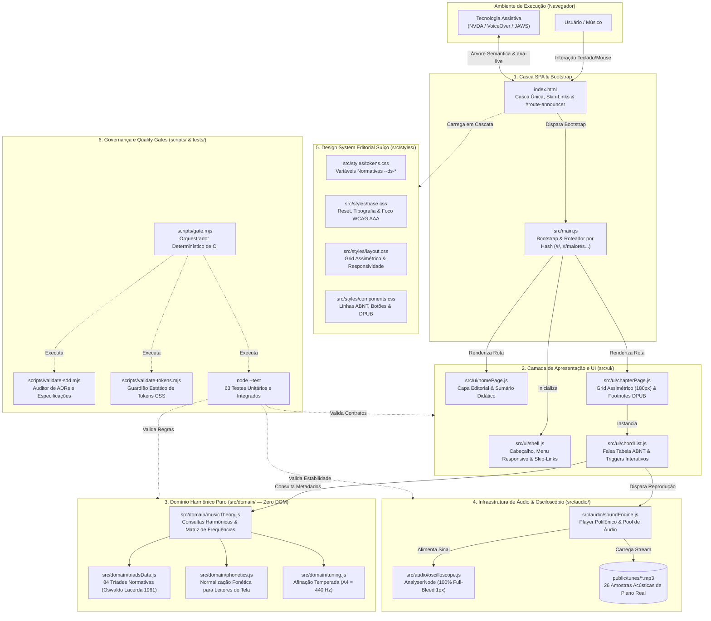
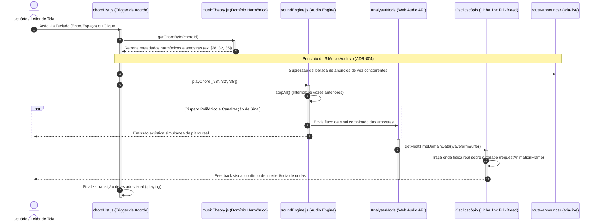

# Acordes Básicos: Guia Acessível de Formação de Tríades

> Arquitetura Front-End Editorial de Alta Acessibilidade (WCAG 2.1 AAA), Teoria Harmônica Estrita, Web Audio com Analisador Acústico e Engenharia Orientada por Especificações (SDD).

[](https://github.com/julianachavespalm/acordes/actions)
[](https://www.w3.org/WAI/WCAG21/quickref/?currentsidebar=%23col_customize&levels=aaa)
[-orange.svg)](#5-design-system-editorial-suíço)
[-blue.svg)](#3-arquitetura-do-sistema-clean-front-end--assistive-first)
[](https://creativecommons.org/licenses/by/4.0/)

**Aplicação em Produção:** [julianachavespalm.github.io/acordes](https://julianachavespalm.github.io/acordes/)

---

## 1. Visão Executiva e Propósito

O **Acordes Básicos** é uma aplicação educacional interativa projetada a partir de princípios avançados de **Engenharia de Acessibilidade**, **Teoria Harmônica Estrita** e **Design Editorial Suíço**. A solução foi desenhada segundo a filosofia *assistive-first*, proporcionando autonomia cognitiva e sensorial plena para pessoas cegas usuárias de leitores de tela (NVDA, VoiceOver, JAWS, Narrador), pessoas com baixa visão e músicos profissionais.

Diferente de aplicações musicais convencionais que dependem de notação visual gráfica inacessível ou emissões sintéticas ruidosas, cada componente harmônico é estruturado como uma entidade semântica navegável via teclado, com transcrição fonética para audiodescrição, execução polifônica de piano acústico real e análise física de sinal sonoro em tempo real.

---

## 2. Inovações de Engenharia e Acessibilidade

### 2.1. Acessibilidade Nativa WCAG 2.1 AAA e Contraste Absoluto
- **Contraste 17.8:1:** Tipografia em tinta preta (`#111111`) sobre papel off-white (`#FAFAFA`), superando a razão normativa de 7:1 exigida pelo nível AAA da WCAG 2.1.
- **Anel de Foco Unificado:** Navegação por teclado com contorno de alto contraste duplo (âmbar `#FFB800` e preto `#111111`), garantindo visibilidade imediata sem dependência exclusiva de cor.
- **Double Skip-Links:** Mecanismos de salto direto (`Ir para o conteúdo principal` e `Ir para o menu de navegação`) posicionados como primeiros elementos do DOM.

### 2.2. Falsa Tabela ABNT (Linearização Semântica)
- **Eliminação do Ruído de Coordenadas:** Tabelas HTML tradicionais impõem sobrecarga cognitiva a pessoas cegas devido à leitura repetitiva de coordenadas de grade.
- **Estrutura Adaptada:** A relação tabular normativa da ABNT é renderizada semanticamente como uma lista linear `<ul role="list">` com itens `<li>`, preservando visualmente a estética editorial rigorosa de linhas horizontais sem bordas verticais.

### 2.3. Osciloscópio Acústico em Tempo Real (Web Audio AnalyserNode)
- **Captura da Onda Física Real:** Linha de 1px em largura total (100% full-bleed) posicionada sobre o rodapé, conectada a um `AnalyserNode` da Web Audio API (`fftSize: 2048`).
- **Zero Simulação Sintética:** O traçado renderiza a forma de onda física e a interferência construtiva/destrutiva real das 26 amostras acústicas gravadas, sem recorrer a animações senoidais simuladas em CSS ou canvas arbitrário.
- **Eficiência de Renderização:** Loop via `requestAnimationFrame` que entra em repouso automático quando a energia do sinal atinge o piso de silêncio, liberando a CPU.

### 2.4. Princípio do Silêncio Auditivo
- Durante a execução de notas e acordes polifônicos, qualquer emissão de sintetizador de voz assistivo (`aria-live`) é intencionalmente suprimida. Isso assegura pureza acústica e impede que a voz do leitor de tela concorra com a frequência harmônica analisada pelo estudante.

### 2.5. Notas de Rodapé WAI-ARIA DPUB
- Para atender às enarmonias com triplo sustenido segundo o *Compêndio de Teoria Elementar da Música* de **Oswaldo Lacerda (1961)**, o sistema implementa a especificação **WAI-ARIA Digital Publishing**:
  - Chamada no texto: `role="doc-noteref"` com ancoragem por identificador único.
  - Nota no rodapé: `role="doc-footnote"` com link de retorno bidirecional `role="doc-backlink"` e gestão estrita de foco.

### 2.6. Design Editorial Suíço Rigoroso
- **Tipografia e Hierarquia:** Neo-grotesca neutra (`Inter`, `Plus Jakarta Sans`) baseada na escala modular Minor Third (razão 1.200), com base de 18px e entrelinha de 1.6.
- **Cantos Retos Universais:** Aplicação estrita de `border-radius: 0` em todos os elementos interativos, caixas e componentes, eliminando ornamentos supérfluos.
- **Navegação e Abas:** Menu alinhado à esquerda. A aba ativa é destacada exclusivamente por peso tipográfico em negrito (sem fundo de pílula) e tornada não clicável (`cursor: default; pointer-events: none`), comunicada às tecnologias assistivas via `aria-label="[Título], aba atual"` e `aria-current="page"`.
- **Limpeza Visual:** Ausência de linhas separadoras inferiores redundantes nas tabelas e divisórias artificiais de capítulos.

---

## 3. Arquitetura do Sistema (Clean Front-End & Assistive-First)

A arquitetura do projeto aplica os princípios de **Clean Architecture**, **Inversão de Dependências** e **Unidirectional Data Flow**, operando com **Zero Dependências em Tempo de Execução** (Pure Vanilla ES6+ e CSS3 nativo). 

A camada de domínio harmônico é estritamente pura e isolada do navegador, permitindo execução tanto no DOM quanto em ambientes headless de teste.

### 3.1. Diagrama de Componentes C4 (Nível 3)



---

### 3.2. As 6 Camadas da Arquitetura

| Camada | Escopo | Responsabilidade Arquitetural | Regra de Acoplamento |
| :--- | :--- | :--- | :--- |
| **1. Casca SPA & Roteador** | `index.html`<br/>`src/main.js` | Bootstrap do runtime, observabilidade de mudança de hash (`hashchange`), anúncio no `#route-announcer` (`aria-live="polite"`) e gestão programática de foco para o `<h1>` de destino. | Ponto de entrada raiz. Orquestra a montagem sem ser importada por nenhum módulo interno. |
| **2. UI & Apresentação** | `src/ui/shell.js`<br/>`src/ui/homePage.js`<br/>`src/ui/chapterPage.js`<br/>`src/ui/chordList.js` | Geração de markup semântico, orquestração da Falsa Tabela ABNT, controle de abas ativas sem fundo de pílula, gerenciamento das notas WAI-ARIA DPUB e feedback visual de reprodução. | Manipula o DOM. Consome o Domínio diretamente e recebe o SoundEngine por Inversão de Dependência. |
| **3. Domínio Harmônico** | `src/domain/musicTheory.js`<br/>`src/domain/triadsData.js`<br/>`src/domain/phonetics.js`<br/>`src/domain/tuning.js` | Catálogo fechado e imutável das 84 tríades de Oswaldo Lacerda (1961), fórmulas intervalares, normalização fonética e algoritmo de frequência em Hertz ($A_4 = 440\text{ Hz}$). | **Zero DOM.** Funções puras executáveis em qualquer motor JS sem necessidade de navegador. |
| **4. Áudio & Osciloscópio** | `src/audio/soundEngine.js`<br/>`src/audio/oscilloscope.js`<br/>`public/tunes/*.mp3` | Pool polifônico de áudio, execução simultânea de amostras reais (notas MIDI 28 a 53), cancelamento atômico (`stopAll`) e canalização do sinal para o `AnalyserNode` do osciloscópio de rodapé. | Isolada de regras de negócio. Comunica-se exclusivamente via índices numéricos de amostras e frequências. |
| **5. Design System** | `src/styles/tokens.css`<br/>`src/styles/base.css`<br/>`src/styles/layout.css`<br/>`src/styles/components.css` | Fonte única da verdade visual: escala Minor Third, paleta de alto contraste, grid assimétrico de 180px, cantos retos universais (`border-radius: 0`) e linhas ABNT normativas. | Folhas de estilo declarativas carregadas no cabeçalho da casca SPA. |
| **6. Governança e Gates** | `scripts/gate.mjs`<br/>`scripts/validate-sdd.mjs`<br/>`scripts/validate-tokens.mjs`<br/>`tests/` | Auditoria determinística automatizada: conformidade estrita SDD, detecção de valores hardcoded em CSS e execução nativa dos testes unitários em milissegundos. | Ferramental de engenharia executado no CI e pré-commit. Não compõe o bundle de produção. |

---

### 3.3. Fluxo de Execução Crítico: Disparo Harmônico e Análise de Sinal



---

### 3.4. Matriz de Invariantes e Decisões Arquiteturais

| Dimensão | Decisão Adotada | Rationale Técnico | Trade-off Assumido |
| :--- | :--- | :--- | :--- |
| **Runtime** | Zero Runtime Dependencies | Elimina vulnerabilidades de cadeia de suprimentos, quebras de versão e overhead de parsing de bibliotecas. | Requer manipulação declarativa manual da árvore do DOM. |
| **Domínio Harmônico** | Pure Domain (Zero DOM) | Assegura portabilidade total do catálogo de tríades e execução de testes unitários em velocidade máxima no Node.js. | Demanda integração explícita entre as estruturas do domínio e os adaptadores de UI. |
| **Acessibilidade Estrutural** | Falsa Tabela ABNT (`role="list"`) | Evita a repetição de coordenadas em leitores de tela mantendo a composição visual normativa de linhas horizontais. | Exige regras de estilização refinadas para garantir fidelidade visual ao padrão ABNT. |
| **Análise de Sinal** | AnalyserNode Real | Apresenta a forma de onda acústica autêntica e física das notas tocadas, com valor pedagógico real para o estudante de música. | Requer atenção à gestão de ciclo de vida e interrupção de frames ociosos. |
| **Navegação e Abas** | Aba Ativa em Negrito Não Clicável | Comunica claramente a página em exibição sem poluição visual de pílulas coloridas, prevenindo recarregamentos supérfluos. | Necessita de atualização de atributos `aria-label` e `aria-current` a cada transição de rota. |

---

## 4. Estrutura de Diretórios

```text
acordes/
├── .github/workflows/                  # Automação de CI/CD para qualidade e auditoria
│   └── ci.yml
├── .specs/                             # Governança viva SDD (Spec-Driven Development)
│   ├── STATE.md                        # Estado atual do projeto, backlog e decisões ativas
│   ├── decisions/                      # Architecture Decision Records formais (ADR-001 a ADR-011)
│   ├── features/                       # Especificações funcionais normativas (FEAT-001 a FEAT-007)
│   └── project/                        # Atributos de qualidade, visão de produto e glossário
│
├── public/                             # Assets estáticos servidos de forma estática
│   ├── favicon.ico
│   └── tunes/                          # 26 amostras acústicas gravadas de piano (28.mp3 a 53.mp3)
│
├── scripts/                            # Ferramental determinístico de engenharia e CI
│   ├── gate.mjs                        # Orquestrador unificado de Quality Gates
│   ├── serve.mjs                       # Servidor local de homologação nativo
│   ├── validate-sdd.mjs                # Auditor determinístico de integridade SDD
│   └── validate-tokens.mjs             # Guardião contra valores CSS literais fora dos tokens
│
├── src/
│   ├── main.js                         # Ponto de entrada SPA, Roteador por Hash e gestor de foco
│   │
│   ├── domain/                         # Domínio Harmônico Puro (Zero DOM / Node nativo)
│   │   ├── musicTheory.js              # Consultas harmônicas e facade de regras musicais
│   │   ├── triadsData.js               # Catálogo imutável das 84 tríades normativas
│   │   ├── phonetics.js                # Normalização fonética e descrições para leitores de tela
│   │   └── tuning.js                   # Algoritmos de frequência e matriz temperada (A4 = 440 Hz)
│   │
│   ├── audio/                          # Infraestrutura de Áudio e Sinal Acústico
│   │   ├── soundEngine.js              # Web Audio Engine e reprodutor polifônico
│   │   └── oscilloscope.js             # AnalyserNode em tempo real (100% Full-Bleed 1px)
│   │
│   ├── ui/                             # Camada de Apresentação, Componentes e A11y
│   │   ├── shell.js                    # Cabeçalho, menu de navegação e skip-links
│   │   ├── homePage.js                 # Capa editorial e sumário didático
│   │   ├── chapterPage.js              # Grid capitular assimétrico e notas de rodapé DPUB
│   │   └── chordList.js                # Falsa tabela ABNT e gatilhos de reprodução
│   │
│   └── styles/                         # Design System Editorial Suíço em 4 Camadas
│       ├── tokens.css                  # Fonte única da verdade para variáveis normativas (--ds-*)
│       ├── base.css                    # Reset, tipografia, foco WCAG AAA e cantos retos
│       ├── layout.css                  # Grid assimétrico (180px + 65ch) e responsividade
│       └── components.css              # Componentes de interface, falsa tabela e notas DPUB
│
├── tests/                              # Suíte de Testes Nativos (Node.js Test Runner)
│   ├── audio/soundEngine.test.js       # Testes unitários do motor de áudio e osciloscópio
│   ├── core/musicTheory.test.js        # Testes unitários das 84 tríades e afinação
│   └── ui/                             # Testes de integração, DOM, acessibilidade e rotas
│
├── index.html                          # Casca única SPA pré-renderizada com container #app
├── package.json                        # Declaração de scripts de engenharia e dependências
└── README.md                           # Documentação viva de arquitetura do sistema
```

---

## 5. Design System Editorial Suíço

O design visual fundamenta-se no **Estilo Tipográfico Internacional (Design Suíço)** e na **ADR-008**, priorizando clareza semântica, legibilidade extrema e precisão funcional:

- **Paleta e Contraste:** Tinta `#111111` sobre papel `#FAFAFA` (razão de contraste de **17.8:1**, superando a exigência WCAG AAA de 7:1). Destaque em âmbar `#FFB800` com anel de foco duplo de 3px.
- **Escala Tipográfica Modular:** Razão Minor Third (1.200) com tamanho base de 18px e entrelinha de 1.6, auditada matematicamente contra valores hardcoded.
- **Menu de Navegação e Abas:** Alinhamento à esquerda, cantos retos universais (`border-radius: 0`). A aba ativa é identificada unicamente pelo negrito tipográfico sem fundos de pílula artificiais, com remoção de ação de clique redundante (`cursor: default; pointer-events: none`).
- **Grid Assimétrico de Capítulo:** Sidebar lateral de 180px contendo o título vertical rotacionado em 90 graus, travessão centralizado e fórmula intervalar estrutural (`1 · 3 · 5`), complementada pela coluna de leitura de 65 caracteres (`--ds-measure-reading`).

---

## 6. Governança SDD e Qualidade Contínua

O ciclo de desenvolvimento é estritamente governado pelo framework **Spec-Driven Development (SDD)**:

| Artefato | Finalidade de Engenharia | Status |
| :--- | :--- | :--- |
| **ADRs (001 a 011)** | Registro imutável de decisões arquiteturais, racional técnico e trade-offs assumidos | Conforme |
| **FEAT-001 a FEAT-007** | Especificações com requisitos em notação EARS e critérios de aceitação formais | Conforme |
| **Validador SDD** | Script determinístico que audita a consistência entre especificações, decisões e estado | 100% Conforme |
| **Validador de Tokens** | Guardião estático em CI que impede cores hexadecimais ou medidas literais fora de `tokens.css` | 100% Conforme |
| **Suíte de Testes Nativos** | 63 testes unitários e de integração executados em menos de 300ms via `node --test` nativo | 63/63 Aprovados |

---

## 7. Como Executar Localmente

### Pré-requisitos
- Node.js v20+ (sem necessidade de bundlers, Webpack, Vite ou dependências externas de runtime).

### Comandos de Engenharia
```bash
# 1. Clonar o repositório
git clone https://github.com/julianachavespalm/acordes.git
cd acordes

# 2. Executar a suíte de testes unitários nativa (execução em <300ms)
npm test

# 3. Executar o Quality Gate unificado (validação SDD + Tokens CSS + Testes)
npm run gate

# 4. Iniciar o servidor de homologação local nativo
npm start
```
Acesse a aplicação em `http://localhost:3000`.

---

## 8. Autoria e Liderança Técnica

Projetado e desenvolvido por:

**Juliana Chaves Palm**  
*Software Engineer & Solution Designer*  
Especialista em Arquitetura Front-End, Design Systems e Engenharia de Acessibilidade Assistiva (WCAG / WAI-ARIA).

- **Portfólio / GitHub:** [github.com/julianachavespalm](https://github.com/julianachavespalm)
- **LinkedIn:** [linkedin.com/in/julianachavespalm](https://www.linkedin.com/in/julianachavespalm/)

---

*Distribuído sob licença Creative Commons Attribution 4.0 International (CC BY 4.0).*
